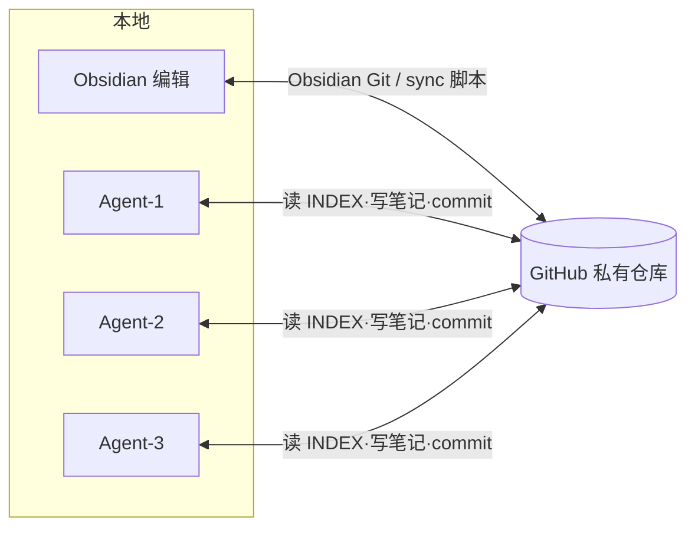

# AI Company Brain · AI 公司知识库模板

> 给多个 AI Agent 共用的「长期共享记忆」——用 Obsidian 查看/编辑，用 GitHub 做本地↔云端双向同步。  
> **本仓库是通用模板**：示例公司「示例科技 AI Studio」、项目A/B、Agent-1/2/3 均为虚构占位，请替换成你自己的内容。

---

## ⏱ 3 分钟上手（Quick Start）

### ① 克隆到本地（约 30 秒）

```bash
git clone <把这里换成你的仓库地址> ai-company-brain
cd ai-company-brain
```

Windows 可用 PowerShell；macOS/Linux 用终端。路径自选，例如 `~/Obsidian/ai-company-brain`。

### ② 用 Obsidian 打开（约 1 分钟）

1. 打开 [Obsidian](https://obsidian.md) → **Open folder as vault** → 选刚克隆的目录  
2. 设置 → 第三方插件 → 打开「受限模式」旁的开关 → 浏览社区插件 → 安装并启用 **Obsidian Git**  
3. 打开 Obsidian Git 设置（推荐）：
   - **Pull on startup**：开启  
   - **Auto commit-and-sync interval**：`5`（分钟）  
   - **Pull before push**：开启  
4. 先读 [[INDEX]]，再读 [[AGENTS]]

### ③ 接上你的 Agent（约 1 分钟）

1. 打开 [[AGENT_SETUP]]，把「系统提示词片段」复制到 Grok Bot / Codex / Claude / Cursor  
2. 把克隆路径告诉 Agent  
3. Agent 开工前读 `INDEX.md` + `AGENTS.md`；结束后按模板写笔记并 commit/push  

> 更细的同步方案见 [[SYNC]]。社媒讲解提纲见 `docs/案例讲解提纲.md`。

---

## 这是什么？（What）

一张「公司大脑」地图：

| 谁 | 做什么 |
|---|---|
| **人类** | 用 Obsidian 浏览、改、批注 |
| **多个 AI Agent** | 按 `AGENTS.md` 规则读写同一套 Markdown |
| **GitHub** | 作为唯一云端真相源，多设备/多 Agent 同步 |



---

## 目录怎么放？（Layout）

```
ai-company-brain/
├── INDEX.md              ← 导航地图（Agent 先读）
├── AGENTS.md             ← 所有 Agent 必须遵守的规则
├── AGENT_SETUP.md        ← 如何把本库挂到任意 Agent
├── SYNC.md               ← 双向同步（插件 / 脚本）
├── 00_公司总览/          ← 公司介绍、目标、术语
├── 01_Agent花名册/       ← 每个 Agent 一页（角色/范围/工具）
├── 02_共享记忆/          ← facts / decisions / lessons
├── 03_项目/              ← 项目A、项目B…
├── 04_日志/              ← Agent 日记 YYYY-MM-DD.md
├── 05_模板/              ← 带填写提示的 frontmatter 模板
├── docs/                 ← 案例讲解提纲（社媒用）
└── scripts/              ← sync.ps1 / sync.sh
```

每个文件夹都有 `_说明.md`，打开就能知道「这层放什么、怎么写」。

---

## Agent 如何读/写记忆？

1. **读**：先打开 `INDEX.md` → 按需跳到公司总览 / 花名册 / 共享记忆 / 项目  
2. **写**：一事一笔记；复制 `05_模板/` 里对应模板；填 frontmatter  
3. **放对文件夹**：长期事实 → `02_共享记忆/facts/`；决策 → `decisions/`；踩坑 → `lessons/`；当天流水 → `04_日志/`  
4. **禁止**：密码、Token、Cookie、私钥、`.env` 内容（见 `AGENTS.md`）  
5. **收尾**：写完日记 → `git add` → `git commit` → `git push`（或交给 Obsidian Git）

---

## 同步怎么工作？

- **方案 A（推荐）**：Obsidian Git 插件——启动拉、每 5 分钟自动提交并同步、推前先拉  
- **方案 B**：`scripts/sync.sh`（macOS/Linux）或 `scripts/sync.ps1`（Windows）——`pull --rebase --autostash` → add → commit → push；可用计划任务/cron 定时  

冲突处理见 [[SYNC]]。**从不 force push。**

---

## 许可与安全

- 默认建议保持 **Private**；你自行决定何时公开  
- 公开前务必删掉所有真实密钥、客户数据、内部链接  
- 模板内示例均为 **虚构占位**，可整段替换

